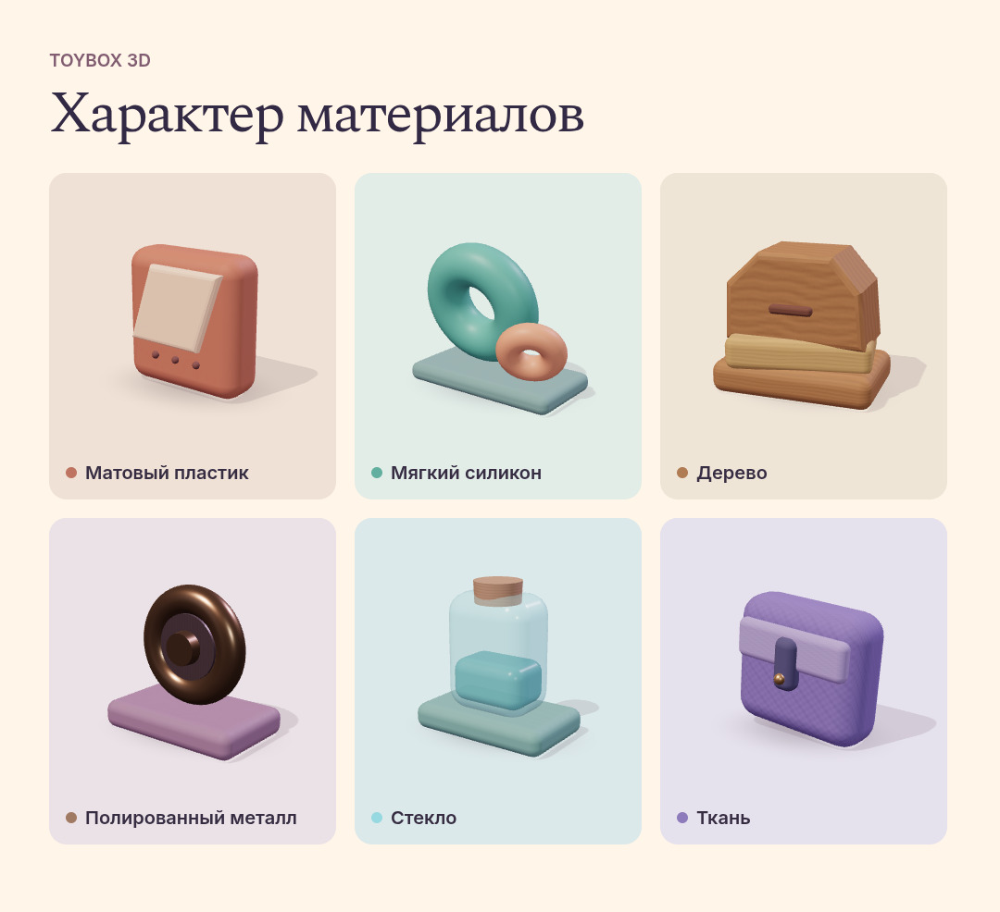

# Style Guide Toybox 3D

Toybox похож на коллекцию миниатюр с общей технологией сборки. Форма рассказывает, как деталь сделана и как может двигаться. Повторяй кольцо, утопленный шов и защёлку в тех местах, где они объясняют устройство. Сохраняй широкие фаски, мягкие окрашенные поверхности и один предмет с насыщенным цветом. Вклад каждого мотива проверяй на уменьшенном кадре.

## Кадры

[Кадры города, интерьера и космоса](../../../renders/toybox-3d/style-guide.jpg) · [Сравнение одной сцены](../../../renders/toybox-3d/comparison.jpg) · [Раскадровка демонстрации](../../../renders/toybox-3d/contact.jpg) · [Ролик «Всего один кофе»](../../../renders/toybox-3d/demo.mp4)

В сравнении оцени читаемость контакта, разведение планов и форму перехода. Low-poly показывает проблему грубых рёбер, однотипных бликов и слабых точек контакта в задаче этого стиля. В статичных кадрах Toybox видны фаски, посадочные места и швы, а в последовательности читаются опора, перенос веса и реакция.

[Материалы под одинаковым светом](../../../renders/toybox-3d/materials.jpg) · [Первый план до и после исправлений](../../../renders/toybox-3d/framing.jpg)

## Геометрия и персонажи

- У крупного объекта выделяй наружный корпус, стык, функциональную часть и два или три заметных признака назначения. В кофейном автомате это дозатор, рабочая ниша и кнопка. В гироскопе это внешняя опора, поворотные кольца и центр измерения.
- Фаску корпуса держи шире, чем фаску мелких деталей. В одном образе сочетай выпуклые объёмы и плоские участки для больших мягких отражений. Используй округлые экструзии, латинги и отдельные накладки там, где сферы и прямоугольники теряют силуэт.
- Персонаж строится вокруг округлой головы с более узкой верхней или нижней частью, цельного силуэта корпуса и ног с широкой опорой. Контрольный масштаб базового персонажа около 2,2 единицы по высоте, центр головы около Y=1,7. Держи крупные глаза внутри лицевой плоскости и меняй брови, веки, зрачки и рот независимо.
- Варьируй причёску, поперечный контур одежды, тон кожи, цветовые блоки и один узнаваемый аксессуар. Голова ведёт внимание, плечи и таз обозначают вес. Заново проверь линию конечностей, когда увеличиваешь ступни или одежду.

## Палитра

Фирменные акценты представлены янтарным `#FFBF47`, коралловым `#FF626B`, голубым `#45B9FF`, фиолетовым `#8664EF`, мятным `#43D9AD` и кремовым `#FFF2DF`. Собирай кадр вокруг одного доминирующего цвета основания, одного родственного вспомогательного цвета и одного акцента. Примерное начальное распределение по площади 65/25/10. Заглушай дальние массы атмосферой и тоном, чтобы лицо, действие и развязка оставались читаемыми.

| Палитра по задаче | Опорный материал | Допустимый яркий акцент |
| --- | --- | --- |
| Город | Кремовый камень, выцветшая бирюза, синевато-серый асфальт | Янтарная кнопка, коралловый навес |
| Природа | Мох, охра, льняной тёплый фон | Мятная листва, янтарный низкий свет |
| Интерьер | Матовая глина, тёплое дерево, приглушённая розовая ткань | Коралловый предмет, персиковая лампа |
| Ночь | Приглушённый синий и виноградный, тёплые окна | Янтарь в единственной точке фокуса |
| Космос | Глубокий чернильный фон и пыльный ультрамарин | Мятный или голубой свет прибора |
| Лаборатория | Холодный кремовый, нейтральные стены, матовая керамика | Мятный активный канал или янтарный индикатор |
| Технологии | Графит и холодный фиолетовый, приглушённые панели | Чистый циан по одной функциональной линии |
| Комедия | Тёплый нейтральный фон дополняет узнаваемый силуэт | Коралловая реакция или янтарный реквизит |
| Напряжение | Сине-чёрный, тусклый индиго, разделённые световые планы | Тёплый знак события |
| Кульминация | Один тёмный или тёплый опорный фон и светлый силуэт | Групповой яркий акцент в области действия |

Направления Toybox City, Science, Space, Gaming, Comedy, Dark, Product и Infographics выбирают разные сочетания палитры, световой схемы и плотности среды. Общими остаются геометрия, тактильность поверхностей, читаемая опора и причинная анимация.

## Материалы и свет

| Семейство | Что зритель видит |
| --- | --- |
| Матовый и глянцевый пластики, резина, силикон | У пластика широкий матовый или узкий аккуратный блик, у резины слабый блик и низкий контраст, у силикона более мягкий край и небольшая прозрачность в подходящих планах. |
| Окрашенное и сырое дерево, бумага, картон | Краска оставляет слабый рисунок поверхности, древесина имеет направление волокон, бумага рассеивает свет, картон выделяет торец или слой. |
| Металл, полированный металл, стекло и полупрозрачный пластик | Обычный металл имеет мягкий направленный блик, полированный передаёт форму светового отражателя, стекло выделяется краем или отражением, цветной пластик читается с помощью толщины и окраски. |
| Ткань, асфальт, бетон, трава, песок, камень, снег | Каждый рисунок имеет свой масштаб. Ткань заметна на близком плане, асфальт шумит слабее силуэта колеса, бетон имеет поры, песок и снег дают мелкий устойчивый тональный рисунок. |
| Вода, еда, эмиссия | Волна меняет отражение воды, еда сочетает поверхность с видимой структурой разреза, эмиссия показывает работающий объект и ограничена его ближайшей областью. |

Используй небольшие вариации цвета и шероховатости по экземпляру. Микрорельеф на герое должен выглядеть стабильным после масштабирования и сжатия. Подбирай яркость ключевого света по форме фаски, контрового по силуэту, заполняющего по читаемости теней. Контактная тень должна следовать за опорой и ослабевать с высотой. Площадки для дневного, студийного, интерьерного, ночного, космического, лабораторного и кульминационного света настраиваются в библиотеке пресетов.

## Камера, композиция и интерфейс

- Общий план объясняет маршрут или механику, средний показывает перенос веса, крупный показывает контакт или запоздалую реакцию. Начинай макропереход на узнаваемом крае и сохраняй направление движения между масштабами. Снижай плотность деталей у глаз и текста.
- Начальные границы универсального макета на 1080×1920 в пикселях: X 96–900, Y 300–1240. Это консервативная рабочая зона для текста и ключевого действия. Интерфейсы публикации и рекламы различаются. Проверь отдельные загруженные превью, включая длинную подпись и правую колонку элементов управления. [TikTok](https://ads.tiktok.com/help/article/tiktok-reservation-in-feed-ads-reach-frequency), [YouTube](https://support.google.com/google-ads/answer/13547298), [Meta](https://business-auth.facebook.com/business/learn/video/reels-best-practices).
- Встроенные пресеты используют Rubik 800 для заголовков, IBM Plex Mono 600 для технических карточек и Inter 700 для мягких подписей. Для новых оформлений также доступны Manrope и Golos Text. Семейства поддерживают кириллицу и распространяются по OFL. Используй один заголовочный и один текстовый стиль, одинаковые отступы, подложку и видимый контраст. Храни файлы закреплённой версии шрифта в проекте вместе с лицензией, если нужно гарантировать идентичные глифы. [Rubik](https://fontsource.org/fonts/rubik), [IBM Plex Mono](https://fontsource.org/fonts/ibm-plex-mono), [Inter](https://fontsource.org/fonts/inter), [Manrope](https://raw.githubusercontent.com/google/fonts/main/ofl/manrope/METADATA.pb), [Golos Text](https://raw.githubusercontent.com/google/fonts/main/ofl/golostext/METADATA.pb).
- Размер начала проверки на мастере 1080×1920: 84–126 px у заголовков, 54–72 px у субтитров, 42–60 px у коротких подписей. У счётчиков используй цифры одинаковой ширины. Для караоке выделяй одно текущее слово, сохраняй позицию всей строки и проверь 360×640.

## Первые исправления на просмотре

| Наблюдение | Исправление |
| --- | --- |
| Реквизит блестит одинаково | Замени второстепенные блики матовыми поверхностями, добавь подлинное дерево, ткань или бетон с другой частотой рисунка. |
| На крупном плане видна пустая стенка | Добавь шов, толщину, рамку или небольшую функциональную накладку в связи с действием. |
| Смешная реакция теряется | Убери движение на фоне на несколько кадров, сохрани крупность и переключи взгляд героя на результат. |
| Эффект похож на универсальный фильтр | Прикрепи объём пыли к плоскости, используй цвет материала, направь частицы из зоны контакта и сократи число элементов. |
| Световая кульминация выбеливает лица | Снизь экспозицию и эмиссию, оставь видимыми глаза, предыдущий опорный силуэт и разделение планов. |
| Превращение выглядит случайным | Задержи первый стык в кадре, сохрани опору и закончи движением или щелчком, указывающим на новую функцию. |
